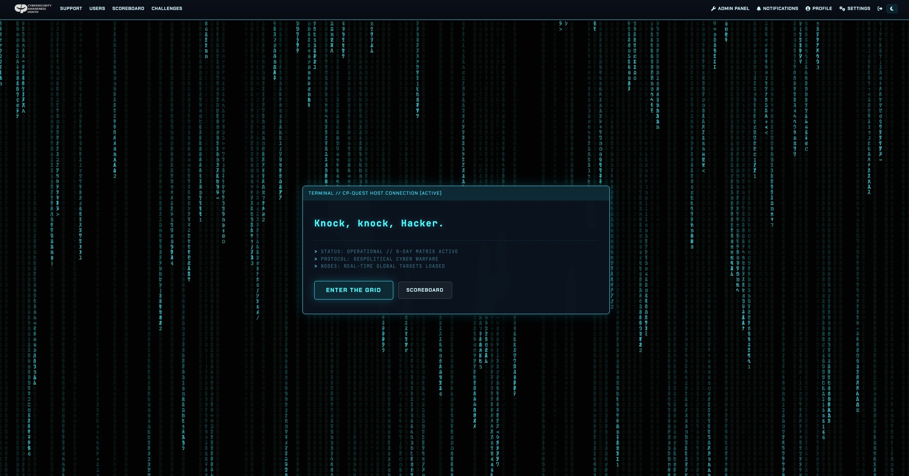
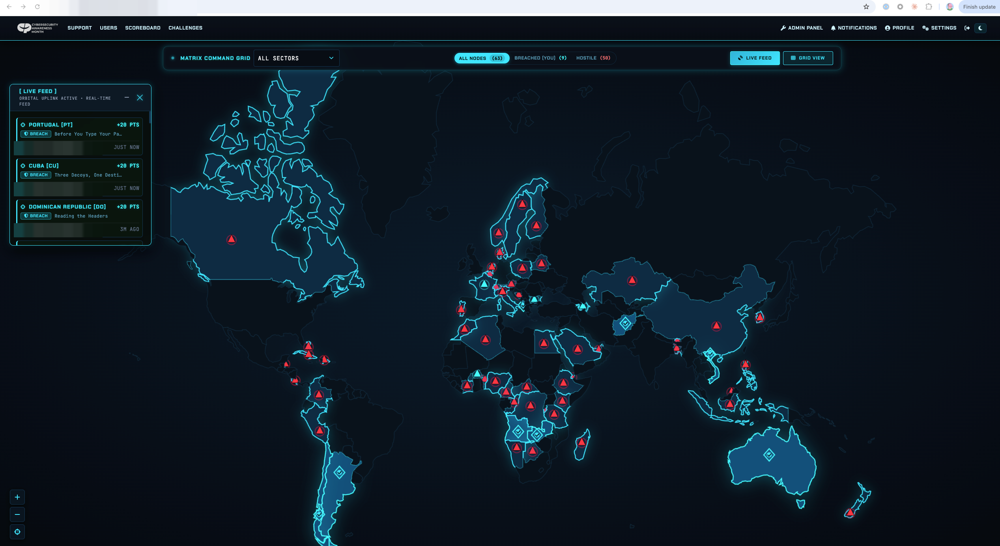
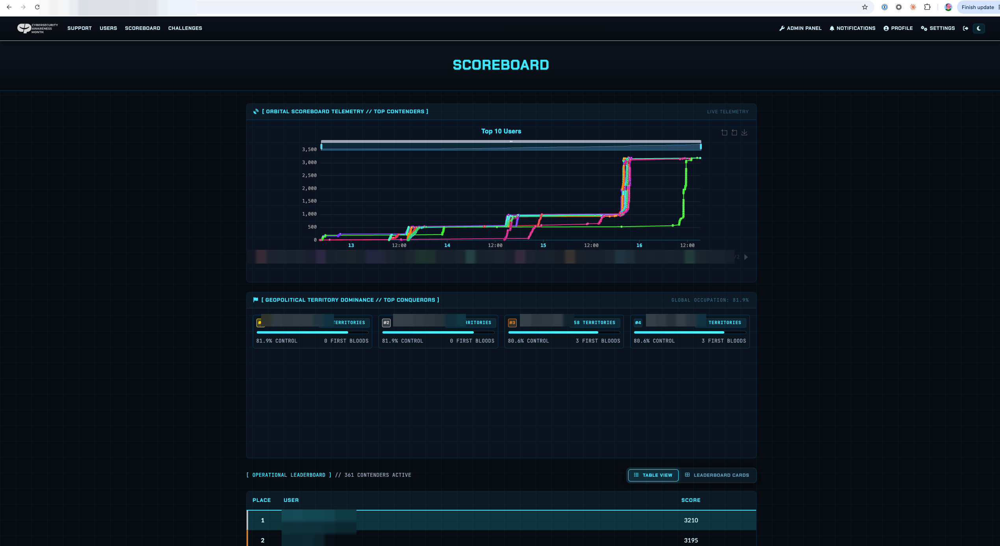
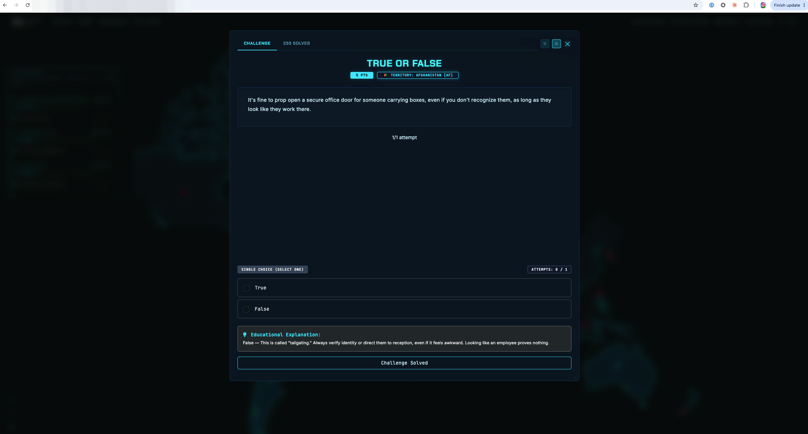

# CPQuest — Custom CTFd Challenge Types & Theme

A collection of custom [CTFd](https://ctfd.io/) challenge-type plugins, platform-feature plugins, and a full tactical/cyber-warfare site theme, built for the Cybersecurity Awareness Month CTF ("CP-Quest").

---

## Screenshots

| Home | Challenges (World Map) |
|---|---|
|  |  |

| Scoreboard | Phishing Inbox Challenge |
|---|---|
|  |  |

| MCQ / Quiz Challenge |
|---|
|  |

> Usernames and URLs in the screenshots above have been blurred for privacy.

---

## Challenge types

Custom challenge formats that plug into CTFd's challenge engine:

| Plugin | Description |
|---|---|
| [`bingo`](bingo.zip) | 3×3/4×4/5×5 bingo board — solve squares, earn bonuses for rows/columns/diagonals, and a grand prize for a full blackout |
| [`crossword`](crossword.zip) | Crossword grid of cyber clues that deduce to a master keyword/flag |
| [`cyber_wordle`](cyber_wordle.zip) | Wordle-style guessing challenge |
| [`quiz_challenges`](quiz_challenges.zip) | Multiple-choice quiz challenge |
| [`branching_scenario`](branching_scenario.zip) | Choose-your-path decision tree with server-driven steps and prerequisites/unlocks between steps |
| [`incident_sequence`](incident_sequence.zip) | Put incident-response steps in the correct order |
| [`phishing_inbox`](phishing_inbox.zip) | Simulated inbox — identify and triage phishing emails |
| [`red_flag_hotspot`](red_flag_hotspot.zip) | Click hotspots on an image to flag suspicious elements |
| [`url_anatomy`](url_anatomy.zip) | Dissect and label the parts of a URL |
| [`image_upload`](image_upload.zip) | Upload a photo/screenshot for manual grading (OSINT, hardware badges, physical access, proof-of-exploitation) |
| [`textarea`](textarea.zip) | Long-form text submission for manual review (writeups, incident post-mortems, threat intel reports) |

## Platform feature plugins

Not challenge types themselves — these extend CTFd's platform behavior:

| Plugin | Description |
|---|---|
| [`chat_notifications`](chat_notifications.zip) | Pushes solves, first-bloods, and admin alerts to Discord, Slack/Mattermost, and MS Teams |
| [`referrals`](referrals.zip) | Gamified recruitment/referral system with anti-cheat (bot, self-referral, and collusion detection) |
| [`sso`](sso.zip) | Enterprise SSO — OAuth2/OIDC/SAML2 identity federation with auto-provisioning |

## Theme

| Theme | Description |
|---|---|
| [`CPQuest-theme-world`](CPQuest-theme-world-2026-10-06.zip) | "World Matrix" — a tactical, map-centric cyber-warfare CTFd theme built on Bootstrap 5, Alpine.js, and Leaflet.js, with full dark/light mode support. Features an interactive GeoJSON world map with 280+ countries, live activity feed, onboarding guide, matrix-rain homepage, and an admin control panel for toggling theme behavior. |
| [`world_theme`](world_theme.zip) | Companion backend plugin for the theme — admin settings page, API endpoints, and country/geo data |

---

## Installation

### Challenge type / feature plugins

1. Unzip the plugin into your CTFd `CTFd/plugins/` directory:
   ```bash
   unzip bingo.zip -d /opt/CTFd/CTFd/plugins/
   ```
2. Restart CTFd so it picks up the new plugin.

### Theme

1. Unzip the theme into your CTFd `CTFd/themes/` directory:
   ```bash
   unzip CPQuest-theme-world-2026-10-06.zip -d /opt/CTFd/CTFd/themes/
   ```
2. Unzip the companion plugin into `CTFd/plugins/`:
   ```bash
   unzip world_theme.zip -d /opt/CTFd/CTFd/plugins/
   ```
3. In the CTFd admin panel, go to **Config → Theme** and select `world`.
4. Restart CTFd.

---

## Submitting / uploading the zip files to CTFd

There are two ways to get these zips onto a CTFd instance, depending on whether you have server/SSH access or only admin panel access.

### Option A — You have server/SSH access (self-hosted)

1. Copy the zip to the server:
   ```bash
   scp bingo.zip user@your-server:/tmp/
   ```
2. SSH in and unzip it into the right directory (`CTFd/plugins/` for plugins, `CTFd/themes/` for the theme) as shown in **Installation** above.
3. Restart the CTFd service/container:
   ```bash
   docker compose restart ctfd   # Docker deployments
   # or
   systemctl restart ctfd        # bare-metal/systemd deployments
   ```

### Option B — Admin panel only (hosted / no server access, e.g. ctfd.io)

CTFd's admin panel supports uploading a **theme** zip directly through the browser:

1. Log in to the admin panel (e.g. `https://<your-ctfd-domain>/admin/challenges` → sidebar).
2. Go to **Admin Panel → Config → Themes** tab.
3. Use the theme upload control to select `CPQuest-theme-world-2026-10-06.zip` and upload it.
4. Once uploaded, pick `world` from the active theme dropdown and **Save**.

> Challenge-type and feature **plugins** (`bingo.zip`, `sso.zip`, etc.) are not installable through the admin panel in self-hosted CTFd — they require filesystem access (Option A). If you're on a managed/hosted CTFd.io plan without server access, open a support ticket with CTFd and attach the plugin zip(s) you need installed.

### Submitting a challenge file (download attachment) to an existing challenge

If instead you just need to attach a downloadable zip to a *challenge* (not install a plugin):

1. **Admin Panel → Challenges**, open the target challenge.
2. Go to the **Files** tab.
3. Click **Upload**, select your zip, and confirm.
4. Save the challenge — the zip now appears as a "Download" link for players on that challenge's page.

---

## Repository structure

```
github/
├── README.md
├── Screenshots/                  # UI screenshots (usernames/URLs blurred)
├── CPQuest-theme-world-*.zip     # Site theme
├── world_theme.zip               # Theme's companion backend plugin
├── bingo.zip
├── branching_scenario.zip
├── chat_notifications.zip
├── crossword.zip
├── cyber_wordle.zip
├── image_upload.zip
├── incident_sequence.zip
├── phishing_inbox.zip
├── quiz_challenges.zip
├── red_flag_hotspot.zip
├── referrals.zip
├── sso.zip
├── textarea.zip
└── url_anatomy.zip
```
